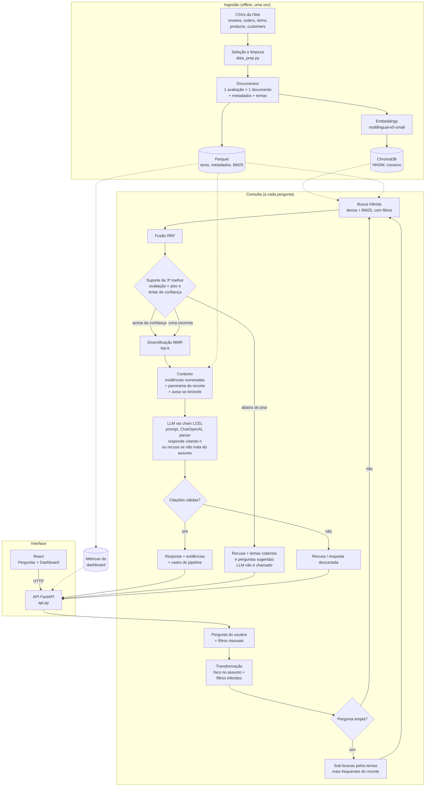

# Voz do Cliente — RAG sobre as avaliações da Olist

Tech Challenge — Fase 4 (FIAP POSTECH). Solução de **Voice of Customer Intelligence**: gestores perguntam em linguagem natural e recebem respostas geradas **somente** a partir das avaliações de clientes do [Brazilian E-Commerce Public Dataset by Olist](https://www.kaggle.com/datasets/olistbr/brazilian-ecommerce/data), com as avaliações que sustentam cada afirmação exibidas ao lado. Quando não há evidência suficiente, o sistema diz que não sabe.

> **Equipe:** Leonardo Botelho (RM 370654) · Rafael Silva (RM 365112) · **Vídeo:** [youtu.be/_8rpNMXXeaM](https://youtu.be/_8rpNMXXeaM)

## Sumário

1. [O problema](#1-o-problema)
2. [Arquitetura](#2-arquitetura)
3. [Como executar](#3-como-executar)
4. [Preparação da base de conhecimento](#4-preparação-da-base-de-conhecimento)
5. [Pipeline RAG](#5-pipeline-rag)
6. [Respostas fundamentadas e perguntas sem evidência](#6-respostas-fundamentadas-e-perguntas-sem-evidência)
7. [Metadados (desafio adicional)](#7-metadados-desafio-adicional)
8. [Avaliação](#8-avaliação)
9. [Exemplos de perguntas e respostas](#9-exemplos-de-perguntas-e-respostas)
10. [Decisões técnicas](#10-decisões-técnicas)
11. [Limitações e próximos passos](#11-limitações-e-próximos-passos)
12. [Estrutura do repositório](#12-estrutura-do-repositório)

## 1. O problema

A Olist tem cerca de 99 mil avaliações de pedidos feitos entre 2016 e 2018. A nota (1 a 5) diz *quanto* o cliente ficou satisfeito; o *porquê* está no comentário escrito, que ninguém consegue ler em escala. Esta solução transforma os comentários em uma base consultável para responder, com evidências, perguntas como:

- Quais são os principais problemas relatados pelos clientes?
- Quais reclamações relacionadas à entrega aparecem com maior frequência?
- O que os clientes mais elogiam?
- Quais avaliações sustentam a conclusão de que há problemas recorrentes de prazo?

## 2. Arquitetura



| Camada | Tecnologia | Papel |
|---|---|---|
| Dados | pandas, pyarrow | Junção, limpeza e base em Parquet |
| Embeddings | `intfloat/multilingual-e5-small` (sentence-transformers) | Vetores de 384 dimensões, multilíngue, roda em CPU |
| Banco vetorial | ChromaDB (persistente, HNSW, cosseno) | Busca densa com filtro de metadados |
| Busca lexical | rank-bm25 | Termos exatos; complementa a busca densa |
| Orquestração | **LangGraph** (`StateGraph`) | Fluxo como grafo de estado: nós `interpretar → recuperar → gerar`, com as recusas como arestas condicionais |
| Geração | **LangChain** (LCEL: `ChatPromptTemplate \| ChatOpenAI \| StrOutputParser`) sobre qualquer API compatível com OpenAI (Gemini, OpenAI, Groq, Ollama...) | Síntese com citações; uma chain por modelo, com fallback entre modelos |
| Observabilidade | LangSmith (opcional, via `.env`) | Trace de cada pergunta: nós do grafo, chain, latência |
| Interface | React + Vite + Tailwind + Recharts, servida por FastAPI; Streamlit e CLI como alternativas | Perguntas com evidências e rastro do pipeline; dashboard de métricas |
| Testes | pytest | 49 testes, sem download de modelo nem chave de API |

## 3. Como executar

Requisitos: Python 3.10+ (testado em 3.12), Node 18+ para a interface React (testado em 22) e alguns GB de disco para as dependências (PyTorch), o modelo de embeddings e o índice.

```bash
git clone https://github.com/Wanderluzter/tech-challenge-4.git
cd tech-challenge-4
python -m venv .venv && source .venv/bin/activate      # Windows: .venv\Scripts\activate
pip install -r requirements.txt
pip install -e .

cp .env.example .env                 # configure o LLM (seção abaixo)

python scripts/download_data.py      # baixa os CSVs para data/raw/
python -m voc_rag.cli prepare        # CSVs → data/processed/documents.parquet
python -m voc_rag.cli index          # embeddings + ChromaDB (alguns minutos em CPU)
python -m voc_rag.cli eval --write   # calibra o limiar de similaridade (ver seção 8)

python -m voc_rag.cli ask "O que os clientes relatam sobre atraso na entrega?"
```

**Interface React (principal)** — requer Node 18+:

```bash
cd web && npm install && npm run build && cd ..   # gera web/dist
uvicorn voc_rag.api:app --port 8000               # interface + API em http://localhost:8000
```

Duas páginas: **Perguntar** (resposta com citações clicáveis, evidências, filtros de metadados e o rastro de cada etapa do pipeline) e **Dashboard**, com três abas — *Base de avaliações* (notas, temas, categorias, efeito do atraso na nota), *Uso do RAG* (perguntas feitas, taxa de recusa por etapa, tempo de resposta; registradas em `data/logs/perguntas.jsonl`, fora do git) e *Qualidade* (resultado do `eval`, incluindo onde o limiar separa perguntas no escopo e fora dele). `/?q=<pergunta>` abre a página já com a resposta. Para desenvolver o frontend com recarga automática: `make api` num terminal e `make web-dev` em outro (http://localhost:5173).

**Alternativa sem Node:** `streamlit run app/streamlit_app.py` abre a interface Streamlit, com as mesmas respostas e evidências (sem o dashboard).

Com `make`: `make setup data prepare index eval web` (ou `app` para o Streamlit).

**LLM.** Edite o `.env` com `LLM_API_KEY`, `LLM_MODEL` e, se não for a OpenAI, `LLM_BASE_URL`. Em `LLM_FALLBACK_MODELS` liste modelos alternativos do mesmo provedor (ex.: `gemini-3-flash-preview,gemini-3.5-flash-lite`): quando um modelo fica sem cota ou não responde em `LLM_TIMEOUT` segundos, a resposta é gerada pelo próximo e a interface avisa qual modelo respondeu. O cabeçalho da interface tem um seletor de modelo que mostra o estado de cada um (disponível, sem cota, com erro). A avaliação (`eval`) nunca troca de modelo no meio da medição. O `.env.example` traz os endpoints dos provedores mais comuns, inclusive Ollama local. Sem nenhuma chave, o sistema roda em **modo extrativo**: recupera e exibe as evidências, lista os temas, mas não sintetiza — útil para testar a recuperação sem custo.

**Sem acesso ao Hugging Face?** `EMBEDDING_BACKEND=lsa` usa um backend offline (TF-IDF de caracteres + SVD). É mais fraco e serve para testes; veja a seção 8.

**Dados.** O script tenta o Kaggle (via `kagglehub`) e, se falhar, o espelho público da própria Olist no GitHub. Também é possível baixar o zip do Kaggle manualmente e extrair em `data/raw/`.

**Testes:** `pytest` (usam uma base sintética mínima gerada no próprio teste).

## 4. Preparação da base de conhecimento

Código: [`src/voc_rag/data_prep.py`](src/voc_rag/data_prep.py). O funil abaixo é gravado em `data/processed/prep_report.json` a cada execução.

| Etapa | Avaliações | Decisão e justificativa |
|---|---|---|
| Arquivo original | 99.224 | — |
| Sem texto (título e comentário vazios) | −56.537 | **Descartadas.** Não há conteúdo a recuperar; preencher texto ausente seria fabricar evidência. A nota delas continua disponível nos dados brutos. |
| `review_id` repetido | −317 | A mesma avaliação aparece ligada a mais de um pedido. Fica uma linha por avaliação, para não inflar a evidência. |
| Texto sem conteúdo (menos de 10 caracteres úteis: "ok", "bom", "recomendo") | −4.083 | Não explicam nada e competiriam com evidências reais no top-k. |
| **Base de conhecimento** | **38.287** | |

- **Seleção dos dados.** O documento é `título + comentário` da avaliação. Dos demais arquivos entram apenas metadados do pedido (seção 7).
- **Limpeza.** Normalização Unicode, remoção de caracteres de controle, quebras de linha e espaços repetidos, e redução de letras repetidas ("ótimoooo"). Acentos e caixa são **preservados** no texto exibido e vetorizado: o modelo de embeddings lida com eles e o LLM lê melhor o texto original. Uma segunda versão (minúsculas, sem acento, sem pontuação) alimenta o BM25 e as regras. A lista de stopwords do BM25 mantém "não", "sem" e "nunca" de propósito — "recebi" e "não recebi" são avaliações opostas.
- **Valores ausentes.** Texto ausente: a avaliação sai da base. Metadado ausente (pedido sem categoria, sem data de entrega): vira categoria explícita (`desconhecida`, `nao_entregue`), nunca um valor imputado.
- **Organização dos documentos.** Uma avaliação = um documento, **sem chunking**. A mediana é de 59 caracteres e o comentário mais longo tem cerca de 200; dividir não traria ganho e quebraria a rastreabilidade "uma evidência = uma avaliação com `review_id`".
- **Textos repetidos.** Há 3.841 textos idênticos a outro ("Não recebi o produto"). Ficam na base, porque repetição é sinal de frequência, e são deduplicados na hora de montar o contexto.
- **Temas.** Cada avaliação recebe temas por regras de palavras-chave ([`themes.py`](src/voc_rag/themes.py)): entrega atrasada, produto não recebido, defeito, produto errado, atendimento etc. Servem para o panorama quantitativo e para expandir perguntas amplas (seção 5).
- **Embeddings e indexação.** Cada documento é vetorizado com o prefixo `passage: ` exigido pela família E5 e gravado no ChromaDB com os metadados filtráveis. O texto vetorizado é só o comentário — os metadados não são concatenados a ele, para não contaminar a semântica; eles atuam como filtro e como contexto para o LLM.

## 5. Pipeline RAG

Código: [`query.py`](src/voc_rag/query.py) → [`retriever.py`](src/voc_rag/retriever.py) → [`generator.py`](src/voc_rag/generator.py), orquestrados em [`pipeline.py`](src/voc_rag/pipeline.py) por um grafo do **LangGraph** (`interpretar → recuperar → gerar`; as recusas antes do LLM são arestas condicionais para o fim do grafo). Cada etapa aparece no painel "Como chegamos aqui" da interface.

**1. Transformação da pergunta.**
- *Foco no assunto.* Gestores perguntam em linguagem analítica ("quais padrões recorrentes aparecem nas avaliações relacionadas a...") e clientes escrevem relatos ("não recebi meu produto"). O vocabulário analítico é removido do texto de busca: `"O que os clientes relatam sobre problemas relacionados à entrega?"` → `"problemas entrega"`. A pergunta original, intacta, é a que vai para o LLM.
- *Filtros inferidos.* Regras extraem filtros de metadados quando a pergunta delimita um grupo: "clientes insatisfeitos" → nota 1–2; "elogiam" → nota 4–5; "principais problemas" → exclui notas 4–5; "nota 3", "em 2018", "categoria beleza e saúde", "entregas insatisfatórias" → pedidos atrasados ou não entregues.
- *Perguntas amplas.* "Quais são os principais problemas?" não tem assunto para buscar — a palavra "problemas" só encontraria quem escreveu "problemas" (inclusive "sem problemas, recomendo"). Nesses casos a busca é decomposta em sub-buscas, uma para cada tema **mais frequente no recorte filtrado**, escritas na voz do cliente ("não recebi o produto, ainda não chegou").

**2. Recuperação semântica.** Busca densa no ChromaDB (cosseno, top 40, com os filtros) e busca lexical BM25 (top 40, mesmo recorte). A densa encontra paráfrases; o BM25 garante termos exatos que o embedding dilui.

**3. Seleção.** Os rankings são fundidos por **Reciprocal Rank Fusion**, que dispensa normalizar escalas de score diferentes. Candidatos abaixo da similaridade mínima saem; textos idênticos contam uma vez; e **MMR** (λ = 0,7) escolhe as 12 avaliações finais equilibrando relevância e diversidade — sem isso, o contexto vira doze variações de "não recebi".

**4. Construção do contexto.** O modelo recebe a pergunta, um **panorama quantitativo** do recorte (total de avaliações, distribuição de notas, temas por frequência) e as evidências numeradas com seus metadados:

```text
[3] nota 1/5 | compra em 2018-02-13 | categoria: moveis_quarto | entrega: sem entrega registrada
"Ja é as egunda vez que tenho problemas com entregas"
```

O panorama existe porque top-k recupera *exemplos*, não *contagens*: sem ele, "com maior frequência" seria um chute do modelo a partir de 12 avaliações.

**5. Geração.** O prompt de sistema ([`generator.py`](src/voc_rag/generator.py)) obriga a usar só o contexto, citar `[n]` em toda afirmação, não extrapolar percentuais das evidências e recusar com um marcador explícito quando elas não respondem à pergunta. Temperatura 0,1.

## 6. Respostas fundamentadas e perguntas sem evidência

**Rastreabilidade.** Toda resposta vem com as avaliações recuperadas: texto, nota, data, categoria, situação da entrega, similaridade, posição nos rankings denso e BM25, `review_id` e a marcação de quais foram citadas. O contexto exato enviado ao modelo também fica visível.

**Três barreiras contra respostas sem suporte:**

| # | Onde | O que faz | Cobre |
|---|---|---|---|
| 1 | Recuperação | Compara a similaridade da 3ª melhor avaliação distinta com dois limiares calibrados. Abaixo do **piso**, recusa e **o LLM nem é chamado**. Entre o piso e o **limiar de confiança** (zona cinzenta), as evidências seguem marcadas como limítrofes e o LLM confirma se tratam do assunto; sem LLM disponível, recusa. Filtros que não retornam nada também recusam aqui. | Pergunta fora do escopo ("capital da França"); recorte vazio |
| 2 | Geração | O modelo é instruído a responder `SEM_EVIDENCIA:` quando nenhuma avaliação recuperada trata do que foi perguntado, e a responder a parte sustentada, declarando o que faltou, quando a cobertura é parcial. | Pergunta do domínio sem resposta na base ("bateria do iPhone 15"); pergunta fora do escopo que caiu na zona cinzenta ("receita de bolo") |
| 3 | Pós-geração | Citações a números inexistentes são removidas; resposta sem nenhuma citação válida é **descartada**. | Modelo que ignora as regras |

**Recusa útil.** A recusa informa em que etapa ocorreu e por quê e, para não ser um beco sem saída, mostra o que a base cobre (os temas mais frequentes do recorte, com contagem) e três perguntas que ela sabe responder, clicáveis na interface.

## 7. Metadados (desafio adicional)

| Metadado | Origem | Uso |
|---|---|---|
| `review_score`, `sentimento` | avaliações | Filtro (inferido ou manual) e contexto |
| `ano`, `data_compra` | pedidos | Filtro e contexto |
| `categoria` | itens → produtos (categoria do 1º item) | Filtro e contexto |
| `entrega_status`, `dias_atraso` | data de entrega × data prometida | Filtro e contexto |
| `uf` | clientes | Filtro manual e contexto |
| `temas` | regras sobre o texto | Panorama e expansão de perguntas amplas |

**Por que melhoram a recuperação.** (1) *Precisão:* "problemas nas avaliações com nota baixa" restringe a busca às 10,7 mil avaliações de nota 1–2 em vez de esperar que o embedding infira sentimento. (2) *Fato x relato:* `entrega_status` vem das datas do pedido, não do texto. "Entregas insatisfatórias" passa a significar pedidos que **de fato** atrasaram ou não chegaram — a nota média desses grupos é 1,88 e 1,48, contra 3,93 dos entregues no prazo. (3) *Contexto para o LLM:* cada evidência chega com nota, data e situação da entrega, o que permite conclusões como "as reclamações de atraso vêm de pedidos entregues após o prazo".

## 8. Avaliação

`python -m voc_rag.cli eval --write --e2e` roda [`eval/perguntas.json`](eval/perguntas.json): **20 perguntas no escopo** (todas as do enunciado + 6 da equipe: aplicativo, troca/devolução, reembolso, embalagem, cobrança/cancelamento e elogios em cama, mesa e banho), **10 fora do escopo** e **4 do domínio sem resposta na base** (bateria do iPhone 15, faturamento, Pix e cashback — os dois últimos têm zero menções nas 38.287 avaliações). Mede filtros inferidos, relevância@k por termos esperados (proxy auditável; não substitui julgamento humano) e a similaridade de suporte — a da 3ª melhor avaliação distinta —, usada para **calibrar a zona cinzenta**: o piso fica uma margem (0,01) abaixo do menor suporte no escopo e o limiar de confiança, uma margem acima do maior suporte fora do escopo. `--write` grava os dois no manifesto do índice; `--e2e` roda o pipeline completo e mostra qual barreira recusou cada pergunta.

### Resultados (configuração final)

Medidos em 17/11/2026 sobre a base real (38.287 avaliações), com `intfloat/multilingual-e5-small` e o LLM `gemini-3-flash-preview` (API do Google, camada gratuita; o `gemini-3.5-flash` estava sem cota). Saída completa em [`eval/resultado.md`](eval/resultado.md); a aba *Qualidade* do dashboard lê a mesma execução. A versão anterior, com um único limiar (0,875), fez 32/34 com o `gemini-3.5-flash` e com o `nvidia/nemotron-3-ultra-550b-a55b:free`.

| Métrica | Backend offline (`lsa`), sem LLM, 25 perguntas | **e5 + Gemini, 34 perguntas** |
|---|---|---|
| Filtros inferidos corretamente | 22/22 | **30/30** |
| Relevância@k por termos (perguntas no escopo) | 0,74 | **0,78** |
| Zona cinzenta calibrada (piso – confiança) | — | **0,865 – 0,884**; 0 erros que o LLM não possa corrigir |
| Decisão ponta a ponta (responder × recusar) | 18/25 | **34/34** (antes: 32/34) |
| Perguntas no escopo respondidas | — | **20/20** (3 delas na zona cinzenta) |
| Perguntas fora do escopo recusadas | — | **10/10** (6 antes do LLM, 4 pelo LLM na zona cinzenta) |
| Perguntas do domínio sem resposta recusadas | — | **4/4** (3 na recuperação, 1 pelo LLM) |

**Os dois erros da versão anterior, e o que mudou:**

- *"Os clientes relatam problemas com reembolso ou estorno?"* — suporte 0,875, exatamente sobre o limiar único; no pipeline completo ficou um fio abaixo e foi recusada. Agora cai na zona cinzenta, o LLM confirma a relevância e responde com 11 citações.
- *"Como os clientes avaliam o atendimento quando têm um problema?"* — o LLM respondia `SEM_EVIDENCIA` porque as avaliações falavam de atendimento ruim, mas pouco de *como* o cliente o avalia. O prompt passou a pedir a parte sustentada em vez da recusa total quando algumas avaliações tratam do assunto; agora responde com 10 citações.

**Leitura.** Com um único limiar, a margem entre perguntas válidas (menor suporte 0,875) e fora do escopo (maior suporte 0,874, "receita de bolo de cenoura") era de 0,001: similaridades do E5 ficam comprimidas numa faixa alta e perguntas novas poderiam cair do lado errado. A zona cinzenta troca esse corte por duas barreiras: o que está claramente fora é recusado sem custo; o que é ambíguo (7 das 30 perguntas de calibração) vai ao LLM, que decidiu certo em todos os casos. O custo é uma chamada ao LLM nessas perguntas; o risco residual é o LLM aceitar uma pergunta fora do escopo na faixa cinzenta, mitigado pela validação de citações.

Para reproduzir: `python -m voc_rag.cli eval --write --e2e` e `python -m voc_rag.cli examples`. Se o LLM ficar indisponível (limite de requisições), a avaliação tenta de novo e, persistindo a falha, marca a pergunta como `erro_llm` em vez de contá-la como respondida; o `examples` não sobrescreve o arquivo.

## 9. Exemplos de perguntas e respostas

[`docs/EXEMPLOS.md`](docs/EXEMPLOS.md) traz dez perguntas com transformação, filtros, funil de recuperação, resposta e evidências — saída real do sistema, sem edição. Foi gerado com o Nemotron (`nvidia/nemotron-3-ultra-550b-a55b:free`); a regeneração com o Gemini parou no limite diário da camada gratuita, e o comando não sobrescreve o arquivo nesse caso.

Trecho (pergunta ampla; resposta do LLM resumida, evidências literais):

> **Pergunta:** Quais são os principais problemas relatados pelos clientes?
> **Filtros inferidos:** nota entre 1 e 3 · **Expandida em sub-buscas:** produto não recebido · devolução/reembolso · entrega incompleta · entrega atrasada · produto com defeito
> **Recuperação:** 199 densos + 200 lexicais → 345 únicos → 262 acima do limiar → 12 no contexto
>
> - **Entrega incompleta / itens faltando** – 1.460 menções (10,4%); diversos relatos de pedidos com itens ausentes [2, 6, 7, 8].
> - **Produto com defeito ou danificado** – 988 menções (7,0%); produtos recebidos quebrados ou sem funcionar [1, 4, 5, 11].
>
> [2] nota 2 — “Pedido incompleto. Meu pedido chegou faltando um item.”
> [4] nota 1 — “Produto já veio com defeito não funciona”

> **Pergunta:** Qual é a capital da França?
> **Status:** sem evidência (recusa na recuperação, LLM não chamado) — 0 avaliações atingiram a similaridade mínima (maior encontrada: 0,82); mínimo exigido: 3.
> **O que a base cobre:** temas mais frequentes, com contagem · **Perguntas que a base sabe responder:** três sugestões clicáveis.

**Revisão manual das respostas.** As afirmações conferem com as avaliações citadas. A ressalva mais relevante: no exemplo 1 o modelo agrupa [9] e [12] como "não recebimento", mas pelos metadados esses pedidos chegaram atrasados — é o tipo de deslize que a validação estrutural de citações não pega (seção 11).

## 10. Decisões técnicas

| Decisão | Alternativa considerada | Por quê |
|---|---|---|
| Uma avaliação = um documento, sem chunking | Chunks de tamanho fixo | Textos curtos; preserva a rastreabilidade por `review_id` |
| `multilingual-e5-small` | Modelos maiores; APIs de embedding | Feito para busca assimétrica em vários idiomas, gratuito e leve o bastante para rodar em CPU. Trocar o modelo é uma linha no `.env` |
| ChromaDB local | FAISS; serviço gerenciado | Persistência e filtro de metadados prontos, sem infraestrutura. Para 38 mil vetores, um serviço seria custo sem benefício |
| Híbrido denso + BM25 com RRF | Só busca densa | Comentários têm termos literais importantes ("nota fiscal", "correios"); RRF é robusto e não tem parâmetro sensível |
| Filtros por regras | LLM extraindo filtros (self-query) | Gratuito, instantâneo, reproduzível e auditável; cada filtro aparece no rastro e pode ser sobrescrito na interface |
| Expansão de perguntas amplas por temas frequentes | HyDE / multi-query por LLM | Guiada pelos dados do recorte, determinística e sem chamada extra ao modelo |
| Panorama quantitativo no contexto | Deixar o LLM estimar frequência | Top-k não conta; frequência precisa vir de agregação sobre a base |
| Temas por palavras-chave | Classificador / clustering | Transparente e barato. É aproximação e é apresentado como tal |
| MMR + deduplicação | Top-k puro | A base tem milhares de comentários quase idênticos |
| Recusa antes do LLM | Confiar só no prompt | Sem contexto não há o que alucinar, e não há custo |
| Zona cinzenta (piso + limiar de confiança) | Um único limiar; reranker | O limiar único separava os grupos por 0,001. Na faixa ambígua o LLM, que já lê as evidências, confirma a relevância, sem modelo extra |
| Recusa com temas e perguntas sugeridas | Só a mensagem de recusa | O gestor sai sabendo o que a base consegue responder, sem afirmar nada que ela não sustenta |
| Validação de citações pós-geração | Confiar no modelo | Garante que toda resposta exibida aponta para evidências existentes |
| API compatível com OpenAI via `ChatOpenAI` | SDK de um provedor (`ChatGoogleGenerativeAI`) | Uma chain só atende OpenAI, Gemini, Groq e Ollama; trocar de provedor é mudar o `.env` |
| LangGraph para orquestrar | Uma função Python sequencial; agente ReAct | O fluxo é fixo e auditável (não há decisão do LLM sobre qual ferramenta usar), mas tem desvios: o grafo torna explícitos os dois pontos de recusa e cada nó aparece separado no trace do LangSmith |
| Fallback entre modelos próprio | `Runnable.with_fallbacks` do LangChain | Mesmo princípio, mas guarda o estado de cada modelo (sem cota, com erro, em cooldown), que a interface mostra no seletor de modelo |
| Busca híbrida própria sobre ChromaDB + BM25 | `EnsembleRetriever` do LangChain | Precisamos da similaridade de cada evidência (para o limiar de recusa), dos dois rankings para o rastro e de filtros iguais nas duas buscas |

## 11. Limitações e próximos passos

- **Similaridades comprimidas.** Com o e5-small, perguntas válidas e fora do escopo ficam separadas por 0,001 de similaridade de suporte (seção 8). A zona cinzenta delega esses casos ao LLM, mas a calibração vem de 30 perguntas; um conjunto maior daria limiares mais confiáveis.
- **LLM gratuito não determinístico e com cota diária.** A mesma pergunta pode ser respondida numa execução e recusada em outra, e a cota de um modelo pode acabar no meio do uso. A cadeia de fallback mantém a interface respondendo, mas modelos diferentes escrevem respostas diferentes; um modelo pago ou local, com temperatura 0, reduz a variação.
- **UF só por filtro manual.** "Clientes de São Paulo" não vira filtro automaticamente; o estado é selecionado na barra lateral.
- **Relevância medida por proxy.** Termos esperados não substituem um conjunto anotado por pessoas; anotar ~50 pares pergunta–avaliação permitiria medir precisão e recall de verdade.
- **Validação de citações é estrutural.** Garante que a citação existe, não que a avaliação citada sustenta a frase. Um verificador (NLI ou LLM-juiz) seria o próximo passo.
- **Temas por regras** têm falsos positivos e negativos; cerca de 36% das avaliações não recebem tema. As contagens são sempre apresentadas como aproximadas.
- **Regras de filtro** cobrem os padrões de pergunta mais comuns; formulações incomuns ficam sem filtro (a busca semântica ainda funciona, e os filtros manuais estão na interface).
- **Categoria do pedido** é a do primeiro item; pedidos com itens de categorias diferentes perdem essa nuance.
- **Sem reranker.** Um cross-encoder multilíngue sobre os candidatos do RRF tende a melhorar a ordenação e a separar melhor o que é relevante, o que estreitaria a zona cinzenta, ao custo de latência.
- **Sem memória de conversa.** Cada pergunta é independente. O próximo passo seria um checkpointer do LangGraph (ou `RunnableWithMessageHistory`) para perguntas de acompanhamento.
- **Avaliação de fidelidade estrutural.** As métricas são recall de filtros, relevância por termos e acerto de recusa; RAGAS (faithfulness, answer relevancy) com LLM-juiz completaria a avaliação, ao custo de chamadas extras ao modelo.

## 12. Estrutura do repositório

```text
├── web/                      # interface React (Vite + Tailwind + Recharts)
│   └── src/pages/            # Ask.tsx (perguntas) · Dashboard.tsx (métricas)
├── app/streamlit_app.py      # interface alternativa em Streamlit
├── src/voc_rag/
│   ├── config.py             # parâmetros (via .env)
│   ├── text.py               # limpeza e normalização
│   ├── themes.py             # taxonomia de temas por regras
│   ├── data_prep.py          # 1. CSVs → base de documentos
│   ├── embeddings.py         # backends de embedding (e5, lsa)
│   ├── index.py              # 2. embeddings → ChromaDB
│   ├── query.py              # 3. transformação da pergunta e filtros
│   ├── retriever.py          # 4. busca híbrida, RRF, limiar, MMR
│   ├── generator.py          # 5. contexto, chain LCEL (prompt | ChatOpenAI | parser), fallback, validação
│   ├── pipeline.py           # grafo LangGraph (StateGraph) e rastro
│   ├── evaluation.py         # avaliação e calibração do limiar
│   ├── api.py                # API FastAPI (serve também web/dist)
│   ├── dashboard.py          # métricas da base, do uso e da avaliação
│   └── cli.py                # prepare | index | ask | eval | examples
├── scripts/download_data.py
├── eval/perguntas.json       # perguntas de avaliação  ·  eval/resultado.md e .json
├── tests/                    # pytest
├── docs/                     # EXEMPLOS.md · PLANO.md · ROTEIRO_VIDEO.md
└── data/                     # raw/, processed/, index/ (gerados; fora do git)
```

Os dados da Olist não são versionados aqui; consulte a página do dataset no Kaggle para os termos de uso.
